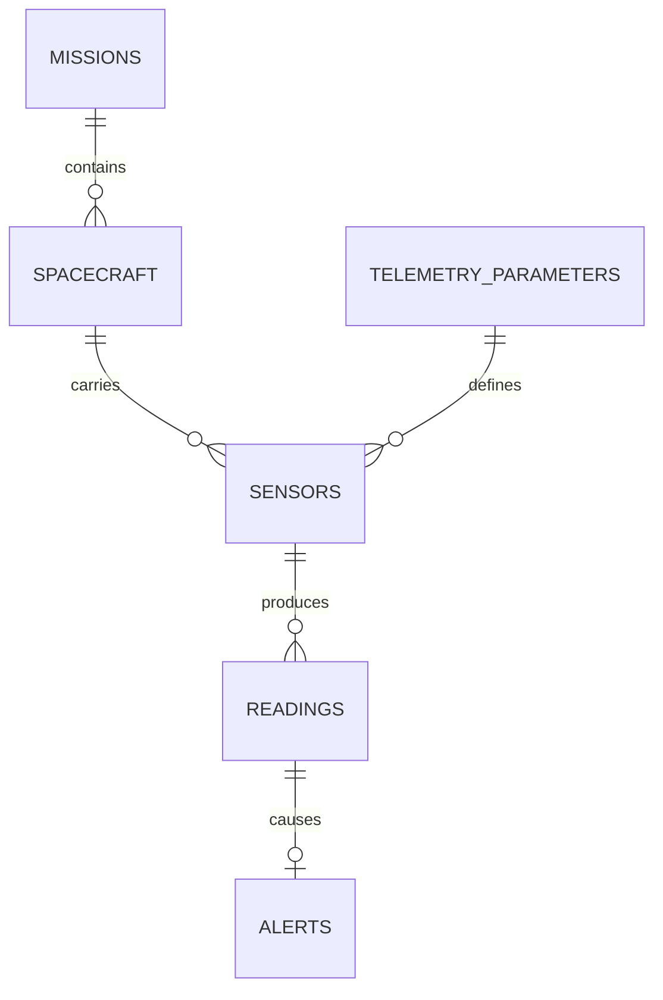

# Database design and review explanation

## Purpose and architecture

The project monitors a simulated 6U Earth-observation spacecraft. Flask generates a complete 15-sensor telemetry batch every ten seconds, sends parameterized SQL to MySQL, and commits the batch as one transaction. The browser requests the latest saved dashboard fragment every ten seconds. All components run locally.

## Entity relationship model

`telemetry_parameters` stores reusable definitions such as display name, unit, category, normal range, critical range, simulator nominal value, and activity rule. `sensors` connects a spacecraft to one telemetry definition. This avoids copying units and limits into every spacecraft sensor or reading.

| Relation | Primary key | Other candidate keys | Foreign keys |
|---|---|---|---|
| missions | mission_id | name | None |
| spacecraft | spacecraft_id | name | mission_id |
| telemetry_parameters | parameter_id | code, name | None |
| sensors | sensor_id | (spacecraft_id, parameter_id) | spacecraft_id, parameter_id |
| readings | reading_id | None | sensor_id |
| alerts | alert_id | reading_id | reading_id |

## Classification and alerts

The deterministic `classify_reading` function returns `NORMAL`, `WARNING`, `CRITICAL`, or `STANDBY`. A value outside the critical range is critical. A value outside the normal range but still inside the critical range is a warning. A context-dependent sensor is standby when it is not expected to be active.

Solar-array current is standby during eclipse. Communication-link health is standby outside a ground-station contact. These states do not create alerts. The trigger creates one alert for every warning or critical reading and stores its severity.

## Simulator behaviour

Normal values drift from their previous reading rather than jumping to unrelated values. Battery charge rises in sunlight and falls during eclipse. Battery current changes direction with that power state. Storage grows between contacts and decreases during a contact. Payload status moves among idle, ready, and imaging during normal operation.

The demonstration compresses sunlight, eclipse, and ground-contact cycles so they can be seen during a classroom presentation. Automatic batches are normal most of the time, with a four percent warning chance and one percent critical chance. Manual controls can generate a normal batch, one warning, or one critical emergency.

## Transactions and concurrency

Python starts a transaction, locks the Satellite-01 row with `SELECT ... FOR UPDATE`, advances its simulation context, reads all fifteen sensors, and calls `add_reading` for each one. MySQL triggers create any required alerts inside the same transaction. One failure rolls back the context, readings, and alerts together.

Changing the spacecraft status also updates the same spacecraft row. Automatic input skips an inactive spacecraft and resumes after it becomes active. A lock prevents a second simulator thread inside the same Python process.

## ACID mapping

| Property | Project behaviour |
|---|---|
| Atomicity | A 15-reading batch and all of its alerts commit or roll back together. |
| Consistency | Foreign keys, unique keys, checks, routines, and triggers enforce the data rules. |
| Isolation | InnoDB transactions and the spacecraft row lock coordinate concurrent requests. |
| Durability | MySQL persists committed telemetry across Flask restarts. |

## Setup paths

Use `database/schema.sql` for a fresh database. Use `database/migrate_v2.sql` once for a database created by the original two-sensor version. Use `database/migrate_v3_diagnostics.sql` once for the earlier fifteen-sensor version. The migrations preserve compatible readings and alerts while installing the current diagnostic definitions.

The limit choices and public references are listed in `docs/TELEMETRY_LIMITS.md`.
