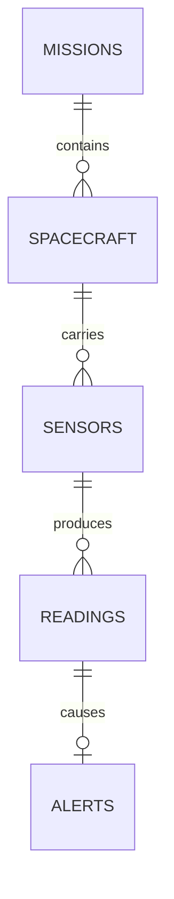

# Database design and review explanation

## Purpose and architecture

The project records simulated sensor measurements for Satellite-01. A Python background thread generates readings immediately at startup and every 10 seconds afterward. It sends parameterized SQL to MySQL and commits one batch per interval. Browser forms provide status updates and manual demonstrations. A small JavaScript timer requests saved tables from Flask every 10 seconds; the browser never receives database credentials.

SQL is the database language. Python is the web-server and simulation language. HTML and CSS provide the frontend. MySQL routines are used; Oracle PL/SQL is not used.

## Entity relationship model

Each child has exactly one parent. Parents may initially have no children. An alert belongs to one reading, and `alerts.reading_id` is unique, so a reading has at most one alert. All foreign keys use MySQL's default restrictive deletion behaviour; they do not cascade.

| Relation | Primary key | Other candidate keys | Foreign key |
|---|---|---|---|
| missions | mission_id | name | None |
| spacecraft | spacecraft_id | name | mission_id |
| sensors | sensor_id | (spacecraft_id, sensor_type) | spacecraft_id |
| readings | reading_id | None | sensor_id |
| alerts | alert_id | reading_id | reading_id |

## Functional dependencies

Assuming the declared business rules:

- `mission_id -> name, purpose, start_date`; unique `name -> mission_id`.
- `spacecraft_id -> mission_id, name, status`; unique `name -> spacecraft_id`.
- `sensor_id -> spacecraft_id, sensor_type, min_value, max_value`.
- `(spacecraft_id, sensor_type) -> sensor_id`.
- The display unit is derived using SQL CASE: Temperature uses C, and Battery uses %. It is not stored redundantly in sensors.
- `reading_id -> sensor_id, measured_value, recorded_at`.
- `alert_id -> reading_id, message, acknowledged`; unique `reading_id -> alert_id`.

## Normalization analysis

An initial combined record could store mission name/purpose/date, spacecraft name/status, sensor type/unit/limits, measured value/time, and alert details together. Mission, spacecraft, and sensor facts would be copied into many reading rows. This creates update, insertion, and deletion anomalies.

We separate those entities by their identifiers. Every column contains one scalar value, satisfying 1NF. Tables use single-column identifier keys and have no partial dependency on a proper subset of those keys. The composite candidate key of sensors also determines its sensor settings.

No stored non-key attribute determines another stored non-key attribute under the stated dependencies. All five relations satisfy 3NF and BCNF. We derive the unit instead of storing it, avoiding the transitive dependency sensor_id -> sensor_type -> unit. If more sensor types and configurable units are added later, a sensor_types lookup table would be appropriate.

Separating spacecraft details from readings is lossless: the child record contains its sensor_id, sensors contains its spacecraft_id, and each referenced parent key uniquely identifies the parent's attributes. Joining through these keys reconstructs the combined record without introducing spurious combinations. Local dependencies are enforced through keys and constraints. Alerts are optional child records, so use a LEFT JOIN when reconstructing rows that may have no alert.

## Closure and minimal cover example

For the sensor relation, `(spacecraft_id, sensor_type)+` includes sensor_id by the unique key, then all sensor attributes by sensor_id's dependency. Therefore it is a candidate key. For `sensor_type+`, the closure contains sensor_type only, so sensor_type is not a key.

A minimal cover with single-attribute right-hand sides contains sensor_id -> spacecraft_id; sensor_id -> sensor_type; sensor_id -> min_value; sensor_id -> max_value; and (spacecraft_id, sensor_type) -> sensor_id. Neither attribute in the composite determinant is extraneous under these rules, and none of the listed dependencies can be removed without losing an attribute from a corresponding closure.

## Database behaviour

The function returns LOW below a minimum, HIGH above a maximum, and NORMAL at or between both limits. The procedure inserts a reading without committing. An AFTER INSERT trigger looks up that sensor's configured limits and inserts an alert for a non-normal value.

Python owns the transaction. A simulation locks the spacecraft row with SELECT FOR UPDATE, verifies its Active status, reads the configured sensors, calls the procedure for every generated measurement, and commits once. An exception rolls back the whole transaction. The rollback demonstration deliberately inserts abnormal values and then rolls back, so both readings and trigger-generated alerts disappear.

Abnormal Battery values are one unit below the configured minimum and may become negative if that minimum is zero. They represent deliberately invalid simulator output used to demonstrate alert handling; the readings table accepts abnormal observations rather than constraining every measured value to the allowed range. Temperature abnormal values are one unit above the configured maximum. Values beyond DECIMAL(10,2)'s range cause the batch to roll back.

Changing a spacecraft's status uses UPDATE, which also needs its row lock. Therefore a status change and a simulation on that spacecraft cannot modify/check the locked row concurrently without waiting. Automatic input skips an Inactive satellite and resumes at the next tick when Active. The deliberate rollback demonstration may run while Inactive because it discards all changes. This illustrates a limited concurrency-control mechanism; it is not a proof that all application schedules are serializable.

The automatic worker creates a fresh Flask application context for each batch, giving it its own database connection. Context teardown closes that connection. A Python Event provides an interruptible timer and shutdown signal; a Lock prevents starting a second worker in the same process. A monotonic clock schedules batches without wall-clock adjustments affecting the interval. Browser refresh requests are read-only and cannot start extra workers. The default reading query adds LIMIT 100; the all-history view omits it. Neither view deletes rows. Alerts display their reading_id foreign key while acknowledgement updates their distinct alert_id primary key through a background POST. Run one local Python server process as documented.

The database still supports mission/spacecraft/sensor relationships for normalization exercises. This version limits all dashboard queries and simulation to the uniquely named Satellite-01. Existing records for other satellites are preserved, and fresh seed data contains just Satellite-01.

Limits cannot be edited through this prototype, so historical state classification uses the current stored limits. If limit editing is added later, store limit versions or the limits used at measurement time to preserve historical interpretation.

## ACID in this project

| Property | Explanation |
|---|---|
| Atomicity | All readings and corresponding alerts in a batch commit together or roll back together. |
| Consistency | Foreign keys, unique keys, NOT NULL, and CHECK constraints enforce the declared data rules. |
| Isolation | InnoDB transactions and the spacecraft row lock coordinate concurrent requests; isolation level still matters. |
| Durability | Committed rows persist in MySQL across application restarts. Crash guarantees depend on MySQL configuration and hardware. |

Closing a request's connection also releases its resources and any outstanding transaction. SELECT requests do not write changes. All inserts/updates explicitly commit through the write helper or simulation route.

## Units 1 to 4 mapping

| Unit | Included in project | Separate explanation or future demonstration |
|---|---|---|
| 1 | ER model, relational tables, keys, design process, three application layers | Evolution, Codd's rules, EER specialization, ANSI/SPARC schema levels |
| 2 | Functional dependencies, closure/minimal cover example, normalization analysis | 4NF, multivalued dependency, synthesis algorithms |
| 3 | DDL/DML, JOIN, date/string/numeric functions, aggregates, GROUP BY/HAVING, nested query, UNION, procedure/function/trigger, TCL | Optional DCL statements in review_queries.sql; relational algebra discussed below |
| 4 | InnoDB storage, a composite index, EXPLAIN, commit/rollback, row locking | Conflict/view serializability proofs, larger optimization dataset, backup/restore; no custom recovery algorithm or Parquet pipeline |

Do not claim that using MySQL implements every syllabus topic. MySQL manages internal storage and recovery; the project demonstrates selected features.

## Relational algebra mapping

Selection means choosing rows, implemented with WHERE. Projection means selecting columns, implemented with SELECT; use DISTINCT when mathematical set semantics require duplicate elimination. Joining relations uses JOIN ... ON. The Battery example in review_queries.sql selects Battery sensor rows, joins spacecraft and readings, and projects the spacecraft name and measured value. UNION provides set union with duplicate elimination.

## Mid-semester completion estimate

The original core was estimated at roughly 65% completion. Timed simulation and pause/resume are now complete; setup has been simplified to one monitored satellite. Remaining final-review work covers export/reports, a two-session concurrency experiment, and backup/restore plus larger query-plan analysis. Reassess the percentage against the final scope rather than keeping the old estimate.
